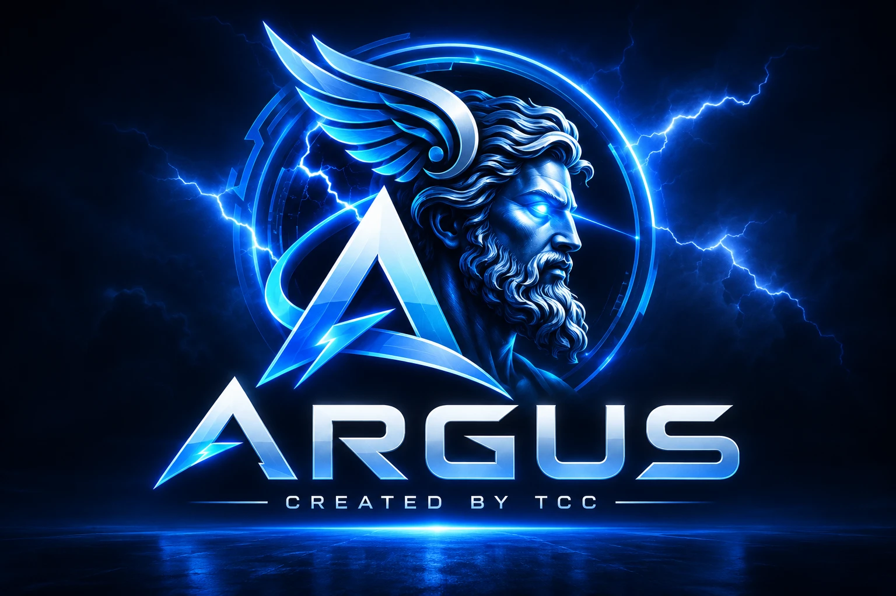

# ARGUS — Risk & Regulatory Intelligence Copilot
## 30-Day Architecture & Build Plan



**Project:** **ARGUS** · *Created by TCC*
**Hackathon:** Snowflake CoCo Hack — GCC Edition
**Track:** Risk, Fraud and Regulatory Intelligence Copilot
**Tagline:** *The hundred-eyed guardian — Signal → Evidence → Finding, correlated across fraud and regulation.*

> **Why "ARGUS":** In Greek myth, Argus Panoptes ("all-seeing") was the giant with a hundred eyes who never fully slept — the perfect guardian. That is exactly what this platform is: an ever-watchful copilot that sees across banks (the cross-institution blind spot no single eye can cover) and across regulation, and never stops watching (scheduled, unattended runs).

---

## 0. TL;DR — What we are building

A single **Risk & Regulatory Intelligence platform** for GCC banking/NBFC that closes a feedback loop nobody automates today:

> **Fraud reality** (what bad actors actually do across banks) ⇄ **Regulatory obligation** (what the rules require you to detect, control, and report).

Two halves on one shared spine:

1. **Consortium Fraud Intelligence** — privacy-preserving, **cross-institution** mule/fraud-network detection using **Snowflake Data Clean Rooms**, with a **self-discovering typology engine**.
2. **Living Regulatory Digital Twin** — a queryable `regulation → obligation → control → data → transaction` model that, when a new SAMA/CBUAE circular drops, computes control gaps and non-compliant exposure automatically.

**The correlation is the moat:** a discovered fraud typology auto-maps to regulatory obligations and control gaps; a new regulation auto-checks whether a detection already exists. One evidence ledger produces **both** the fraud case **and** the audit-ready regulatory filing.

---

## 1. Why this wins

| Judging axis | How we score |
|---|---|
| **Real-World Relevance** | Cross-bank mule networks + constant GCC regulatory change are the two biggest *unsolved, still-manual* pains for SAMA/CBUAE/CBB/QCB-regulated institutions. |
| **Technical Execution** | Data Clean Rooms, entity resolution, graph typology discovery, semantic views, document AI, multi-agent orchestration, guardrails. |
| **Solution Completeness** | Full flow: signal → evidence → documented finding → filed report → action — demonstrated end to end. |

**The three-layer moat (why others can't copy it):**
1. **Snowflake Data Clean Rooms** — privacy-preserving cross-bank joins are a Snowflake-native primitive a generic LLM stack cannot reproduce.
2. **Living reg→control twin** — nobody maintains a queryable one today.
3. **The closed loop** — fraud reality and regulatory obligation continuously update each other. That adaptive loop is the genuinely new thing.

---

## 2. Hackathon compliance guardrails (READ FIRST)

The rules require **CoCo (CLI + Desktop) used across the full lifecycle** and **Snowflake as the data/compute platform**. Google services are permitted **only as additional sources via MCP** (Google Drive is explicitly named as an example MCP connector in the brief). To stay inside the lines:

- ✅ **Snowflake is the backbone** — all data, semantic views, pipelines (dynamic tables/streams/tasks), clean rooms, and Cortex functions live in Snowflake.
- ✅ **CoCo is the build tool at every phase** — planning, development, execution, testing. Capture evidence (screenshots/recordings) of CoCo in each phase.
- ✅ **Google = auxiliary via MCP only** — never the system of record, never replacing Snowflake compute.
- ❌ Do **not** move core data processing or the semantic layer to Google Cloud — that would undercut the "Snowflake + CoCo full lifecycle" requirement.

### Required MCP connectors (all via MCP)
| Connector | Role in ARGUS | MCP usage | Status |
|---|---|---|---|
| **Jira** | Case management — every fraud finding opens a governed investigation case | `create_case`, `update_case`, `link_evidence` | **Required** |
| **Google Drive** | Source of unstructured policy/regulation docs (circulars, AML manuals, LC packets) | Read documents → parse with CoCo → load into Snowflake | **Required** |
| **Gmail** | Deliver drafted findings/filings to a compliance reviewer's inbox | Send-with-confirmation action | **Required** |
| **Google Docs** | Render the board memo / regulator-ready finding for human editing | Write drafted memo | **Required** |
| **Slack** | Push high-confidence alerts + surface the Slackbot | Post message, approval buttons | Required |
| **Google Calendar** | Schedule regulatory remediation deadlines derived from a circular | Create events | Optional (nice-to-have) |

> **Jira + Google are core to the demo, not optional.** The action loop is what turns read-only analysis into cross-tool action (a headline bonus), so both are treated as required.

> **Rule of thumb:** Google *reads inputs* and *delivers outputs*. Snowflake *thinks*. CoCo *builds and orchestrates*.

---

## 3. The unifying architecture

### 3.1 Shared spine (build once, both halves use it)

- **One ontology** — the correlation graph:
  `regulation-clause → obligation → control → data/semantic-view → transaction → entity → typology → finding → filing`
- **One evidence ledger** — every claim in every answer is decomposed into atomic claims, each hard-linked to (a) exact transaction rows and (b) exact policy/regulation clause, with a confidence score. **No unbacked claim** by construction.
- **One governed action loop (MCP)** — open cases (Jira), notify partner banks through the clean room, deliver filings (Slack / Gmail / Google Docs).
- **One guardrail layer** — refuse or flag when evidence is thin, a document is missing, or confidence < threshold. Fails safe.

### 3.2 Component diagram (textual)

```
                          ┌─────────────────────────────────────────┐
                          │              CoCo (CLI + Desktop)         │
                          │  planning · dev · execution · testing     │
                          └───────────────┬───────────────────────────┘
                                          │ builds / orchestrates
                                          ▼
┌───────────────┐   MCP    ┌──────────────────────────────────────────────┐
│ Google Drive  │────────► │                 SNOWFLAKE                       │
│ (policy docs) │  read    │                                                 │
└───────────────┘          │  RAW  → dynamic tables/streams/tasks → curated  │
┌───────────────┐          │  Cortex (Search + LLM + Document AI)            │
│ Bank A / B / C│  shares  │  ┌──────────────┐   ┌───────────────────────┐   │
│ (synthetic)   │────────► │  │ Data Clean    │   │  Semantic Views +      │  │
└───────────────┘          │  │ Room (hashed  │   │  Verified Queries      │  │
                           │  │ identifiers)  │   │  (governed NL→SQL)     │   │
                           │  └──────┬────────┘   └──────────┬────────────┘   │
                           │         ▼                        ▼                │
                           │   Cross-bank graph        Reg→Control twin        │
                           │         │                        │                │
                           │         └────────┬───────────────┘                │
                           │                  ▼                                 │
                           │        Correlation engine + Evidence ledger        │
                           └──────────────────┬─────────────────────────────────┘
                                              ▼
              ┌───────────────┐   ┌──────────────────┐   ┌──────────────────┐
              │ Streamlit app  │   │ Multi-agent layer │  │ MCP action loop   │
              │ (investigator) │   │ (see §4)          │  │ Jira/Slack/Gmail  │
              └───────────────┘   └──────────────────┘   └──────────────────┘
```

### 3.3 Data model (core tables)

**Structured (per synthetic bank):** `account`, `customer`, `transaction`, `counterparty`, `device_login`, `identifier_hash` (IBAN/national-ID/phone/device → salted hash for clean room).

**Clean-room shared view:** `shared_bad_actor_signal` (hashed identifier, risk weight, contributing-bank count — **no raw PII crosses**).

**Regulatory twin:** `regulation`, `clause`, `obligation`, `control`, `control_data_lineage`, `control_gap`.

**Correlation + output:** `typology`, `typology_evidence`, `finding`, `finding_claim`, `filing`.

---

## 4. Multi-agent orchestration

**Yes — ARGUS is explicitly a multi-agent system with a dedicated orchestrator.** One **Orchestrator agent** owns the workflow, decides which specialist agent runs next, passes shared context through the **evidence ledger**, and enforces handoff order. The specialists never call each other directly — they report to the orchestrator. This is what the brief means by *"coordinate several agents or skills into one workflow, with clear handoffs and shared context."*

### 4.1 The orchestrator

| | |
|---|---|
| **Role** | Plans the run, sequences specialists, holds shared state, applies the guardrail gate before any action, and stops/escalates on failure. |
| **Handoff protocol** | Each specialist returns a typed result + its evidence into the ledger; the orchestrator validates completeness before advancing. |
| **Failure behavior** | If a specialist returns low confidence or missing evidence, the orchestrator halts the chain and routes to graceful fallback (refuse + explain) rather than proceeding to an action. |
| **Surfaces** | Runs identically from CoCo CLI, Desktop, Snowsight Cloud Agent, and Slackbot. |

### 4.2 Specialist agents

| Agent | Job | Key tools |
|---|---|---|
| **Retriever** | Governed NL→SQL over semantic views / verified queries | Snowflake semantic view |
| **Graph/Typology** | Community + anomaly detection over the cross-bank graph; names & explains emerging typologies; drafts a detection query | Snowflake graph queries, Cortex |
| **Policy** | RAG over regulation & policy docs (from Google Drive → Cortex Search) | Cortex Search |
| **Twin** | Maps typology ↔ obligation ↔ control; computes control gaps & exposure | Ontology queries |
| **Narrative** | Drafts findings / STR / board memo from **grounded claims only** | Cortex LLM |
| **Verifier / Guardrail** | Confirms every claim has ≥1 structured + ≥1 policy citation and clears confidence threshold; blocks otherwise | Rules + Cortex |
| **Action** | Executes real actions via MCP — **Jira** case, partner-bank alert, filing to **Gmail / Google Docs / Slack** | Jira + Google + Slack MCP |

### 4.3 Orchestrated flow (one investigation)

```
User NL question
      │
      ▼
┌──────────────┐   plans + sequences + holds shared context
│ ORCHESTRATOR │◄──────────────────────────────────────────────┐
└──────┬───────┘                                                │
       │ 1                2               3            4         │
       ▼                  ▼               ▼            ▼         │
   Retriever ─► Graph/Typology ─► Policy ─► Twin ──► Narrative   │
   (rows)        (ring found)    (clause) (gap)     (draft)      │
       │                                                │        │
       └──────────────► Evidence Ledger ◄───────────────┘        │
                              │                                  │
                              ▼                                  │
                       Verifier / Guardrail ──── thin? ──────────┘  (refuse + explain)
                              │ pass
                              ▼
                          Action agent
             ┌──────────────┼───────────────┐
             ▼              ▼                ▼
        Jira case    Gmail / Google Docs   Slack alert
```

Clear handoffs, shared context via the evidence ledger, a guardrail gate before any side effect. This satisfies the **multi-agent orchestration** bonus in full.

---

## 5. The correlation loop (the flagship demo)

**Primary direction (build fully): discovered typology → control gap → filing.**

1. Consortium engine discovers a **3-bank fan-in/fan-out mule ring** (11 accounts, 6-day burst) no single bank flagged.
2. Twin: *"This typology maps to CBUAE AML Art. X; control C-12 has **no cross-institution coverage** → gap."*
3. One evidence ledger produces **both** the fraud case (Jira) **and** the regulator-ready control-gap + STR memo (Google Docs / Slack).
4. Guardrail reveal: ask something the data can't support → it **refuses and says why**.

**Secondary direction (show as "also works in reverse"): new regulation → detection gap.**
A new circular lands in Google Drive → Twin identifies the required detection → consortium engine checks if a covering typology/query exists → auto-drafts the missing detection query.

---

## 6. 30-Day build plan (week by week)

> Every task below is done **through CoCo**. Capture evidence per phase.

### Week 1 — Planning + Data foundation *(CoCo: Planning)*
- [ ] Use CoCo to explore the problem, draft this design, and author the **ontology** and workflow.
- [ ] CoCo generates **referentially consistent synthetic data for 3 banks**, with *planted* cross-bank rings + realistic clean noise (never production data).
- [ ] Wire **Google Drive MCP**; drop in synthetic GCC circulars, AML manuals, LC/policy packets.
- [ ] Stand up Snowflake schemas: `RAW`, `CURATED`, `GOVERNED`.
- **Deliverable:** ontology doc + loaded synthetic datasets + policy corpus. **Evidence:** CoCo planning session recording.

### Week 2 — Pipelines, semantic layer, clean room *(CoCo: Development)*
- [ ] CoCo builds ingestion + transformation pipelines (**dynamic tables, streams, tasks**) incl. near-real-time flow.
- [ ] CoCo infers/authors **semantic views + verified queries**; validate against NL questions.
- [ ] Build the **Data Clean Room**: salted-hash identifiers, privacy-preserving join, `shared_bad_actor_signal`.
- [ ] CoCo Document AI / Cortex parses circulars → build the **reg→control twin** tables + Cortex Search index.
- **Deliverable:** working governed NL→SQL + cross-bank graph + queryable twin. **Evidence:** CoCo dev-in-CLI clips.

### Week 3 — Intelligence + Evidence + UI *(CoCo: Development)*
- [ ] **Typology-discovery engine** (community/anomaly detection) + auto-generated explainable detection queries + **typology cards**.
- [ ] **Correlation engine** (typology ↔ obligation ↔ control-gap).
- [ ] **Evidence ledger** + **guardrail/verifier** agent (refuse on thin evidence).
- [ ] CoCo scaffolds the **Streamlit investigator app** (ask, see the ring, click evidence, one-button finding).
- **Deliverable:** end-to-end signal→evidence→finding in the app. **Evidence:** CoCo generating Streamlit.

### Week 4 — Action, automation, hardening, demo *(CoCo: Execution + Testing)*
- [ ] **MCP action loop:** Jira case, partner-bank alert via clean room, filing to Slack / Gmail / Google Docs (send-with-confirmation).
- [ ] **CoCo automations:** scheduled unattended cross-bank scoring run; also surface via **Snowsight Cloud Agent** + **Slackbot**.
- [ ] **Testing via CoCo:** planted-ring recall, false-positive rate, privacy-leakage check, adversarial NL questions, missing-document edge cases.
- [ ] Package the reusable **`consortium-typology`** and **`grounded-finding`** skills (documented for reuse — headline bonus).
- [ ] Rehearse the correlation-loop demo climax + the guardrail refusal.
- **Deliverable:** demoable, hardened, automated solution across surfaces. **Evidence:** CoCo test logs + scheduled-run history.

---

## 7. CoCo lifecycle evidence checklist (judges grade this hard)

| Phase | Concrete CoCo artifact to show |
|---|---|
| **Planning** | CoCo session drafting ontology + solution design |
| **Development** | CoCo building pipelines, semantic views, agents, Streamlit in CLI/Desktop |
| **Execution** | CoCo scheduled/automated cross-bank run + MCP actions firing |
| **Testing** | CoCo validating recall, false positives, privacy leakage, edge cases |

---

## 8. Bonus-points checklist (the "ingenuity" scores)

- [ ] **Reusable skills** — `consortium-typology`, `grounded-finding` (documented, shareable). *Headline bonus.*
- [ ] **MCP connectors (required)** — **Jira** (cases), **Google Drive** (policy docs in), **Gmail + Google Docs** (findings out), Slack (alerts) → read-only becomes cross-tool action.
- [ ] **Automations / scheduled runs** — unattended nightly scoring.
- [ ] **Custom tools / function calling** — `create_jira_case(finding_id)`, `file_regulatory_report(finding_id)`, `alert_partner_bank(signal_id)`.
- [ ] **Multi-agent orchestration** — dedicated **Orchestrator** + 7 specialists, clean handoffs, guardrail gate before any action (§4).
- [ ] **Across surfaces** — CoCo CLI + Desktop + Snowsight Cloud Agent + Slackbot.
- [ ] **Guardrails / graceful fallback** — verifier agent, refusal on thin evidence, missing-doc handling.

---

## 9. Scope discipline (don't dilute)

- Build the **shared spine first** (ontology + evidence ledger + action loop) in Weeks 1–2.
- Build **one correlation direction fully** (discovered typology → control gap → filing). Show the reverse as a lighter "also works" reveal.
- Depth on **one governed, evidence-backed, cross-bank flow** beats breadth. Do NOT try to also cover liquidity + credit + full Basel — mention them as roadmap only.

---

## 10. Demo script (5 minutes)

1. **(30s)** Frame the gap: every bank has a partial view; regulation changes faster than controls.
2. **(60s)** Ask in plain English: *"Show me emerging cross-bank fraud we're exposed to this week."*
3. **(90s)** Copilot surfaces the 3-bank mule ring → click a footnote → jump to exact rows + clause. Show it's cross-bank (impossible without the clean room).
4. **(60s)** Correlation: typology auto-maps to CBUAE AML Art. X + control C-12 gap → one evidence ledger → both a Jira case **and** a regulator-ready memo (Google Docs).
5. **(30s)** Guardrail reveal: ask an ungrounded question → it refuses with a reason.
6. **(30s)** Show CoCo scheduled automation + reusable skill = it runs unattended and other teams can adopt it.

---

## 11. Risks & mitigations

| Risk | Mitigation |
|---|---|
| Clean Room setup is fiddly | Start it Week 2 Day 1; have a fallback "simulated clean room view" that still respects hashing so the demo never blocks. |
| Typology discovery over-fits synthetic data | Plant a *variety* of rings + noise; report false-positive rate honestly. |
| Google MCP auth friction | Google is auxiliary — if it stalls, Slack/Jira MCP still carries the action-loop demo. |
| Over-scoping | Enforce §9. One correlation direction, done well. |
| "Is Google allowed?" question from judges | Point to §2: Snowflake + CoCo are the backbone; Google is an MCP source/sink, exactly as the brief permits. |

---

*Built with CoCo across planning → development → execution → testing. Snowflake is the data & compute backbone; Google services are auxiliary MCP sources and sinks.*
