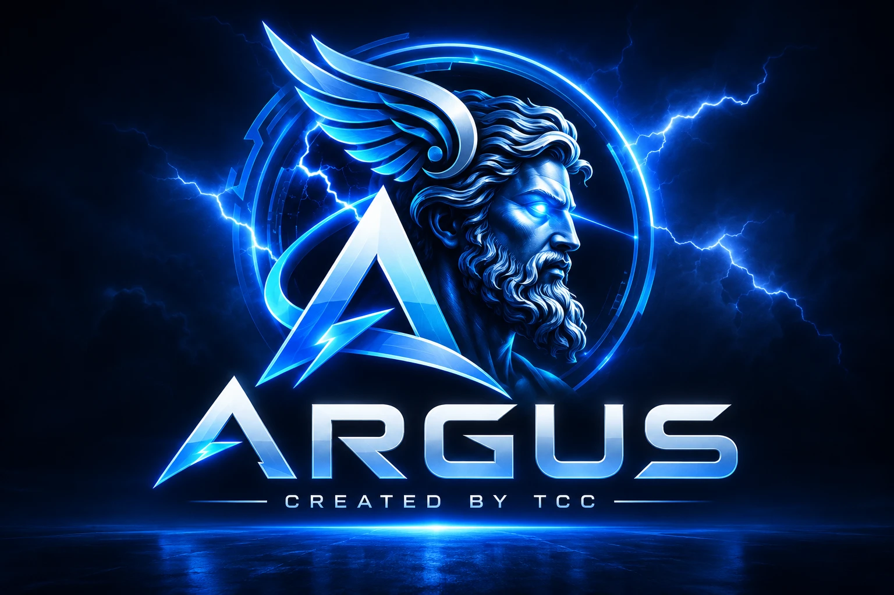
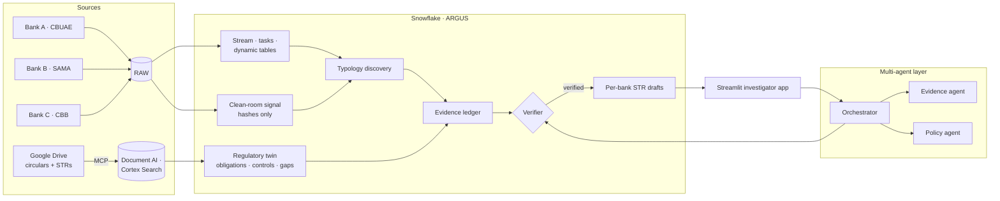

<p align="center"></p>

# ARGUS — Risk & Regulatory Intelligence Copilot

**The hundred-eyed guardian for GCC banks and NBFCs.** *Created by TCC · Snowflake CoCo Hack — GCC Edition.*

Every bank fights fraud with a partial view: mule networks deliberately spread across
institutions, and regulators keep publishing new obligations faster than controls change.
ARGUS closes both gaps on one governed Snowflake platform — it **sees across banks without
sharing customer data**, **discovers fraud rings no single bank can see**, maps them to the
**CBUAE, SAMA, CBB and FATF rules** they breach, and turns that into **evidence-backed,
per-bank STR drafts** that a compliance officer reviews and approves.

> Signal → evidence → finding → filing — every claim traceable to a transaction and a clause.

---

## What it does

| Capability | How | Verified result |
|---|---|---|
| **Cross-bank signal without sharing data** | Salted hashes of identifiers in a secure clean-room view; per-bank roles with row isolation and tag-based PII masking | Each bank sees only its own 180 customers yet the same 8 cross-bank signals; analysts see PII as `***MASKED***` |
| **Real-time detection** | Stream → serverless task graph → incremental dynamic tables → alerts | A ring forming live is flagged at the exact batch it completes; 0 false alerts; ≈ $1 of credits |
| **Typology discovery** | Graph expansion from seed signals over transfer + identity edges → communities → roles & classes | 5/5 planted rings found exactly; **9/9 hidden source mules** per mule ring (per-account rules: 0/9); 0 clean accounts flagged |
| **Living regulatory twin** | Circulars (PDF, from Google Drive via MCP) parsed with `AI_PARSE_DOCUMENT`, obligations extracted with a JSON schema, class-based typology → obligation → control-gap mapping | Extraction 10/10; new articles go to a human-review queue; gaps computed per typology |
| **Evidence ledger + Verifier** | Claims computed by SQL, each citing transactions **and** a clause; deterministic guardrail | Tampered claim caught; weak-signal case refused with a reason; no filing without verification |
| **Per-bank STR drafts** | One STR per bank to its own FIU (UAE FIU goAML · KSA GDFI · Bahrain FID), citing only that bank's IDs; numeric grounding check | 46/46 findings tests; every draft awaits human approval — nothing is sent |
| **Plain-English Q&A** | Semantic views for Cortex Analyst; multi-agent orchestrator (Evidence + Policy Cortex Agents, deterministic Verifier/Narrative) with a handoff log | Ontology questions 5–6/6 verbatim; end-to-end orchestrator 12/12; PII and speculation refused |

---

## Architecture



Built and operated with **CoCo (Cortex Code)** across the whole lifecycle — see
[`evidence/README.md`](evidence/README.md) for every session's brief, transcript and
independently verified results, including an **integrity log** of what went wrong and how
it was fixed.

---

## Repository map

| Path | Contents |
|---|---|
| [`BUILD_PLAN.md`](BUILD_PLAN.md) | 30-day architecture and build plan |
| [`ontology/`](ontology/) | ARGUS ontology — the shared spine |
| [`sql/`](sql/) | All Snowflake objects, numbered in run order |
| [`app/`](app/) | Multi-agent orchestrator (and the Streamlit app) |
| [`semantic/`](semantic/) | Semantic views (generated from the deployed views) and verified queries |
| [`validation/`](validation/) | Test harnesses and reports (offline + Snowflake) |
| [`coco/prompts/`](coco/prompts/) | The brief given to CoCo for each build session |
| [`evidence/`](evidence/) | CoCo transcripts, session summaries, lifecycle evidence index |
| [`data/`](data/), [`data_generator/`](data_generator/) | Deterministic synthetic data (3 banks, planted rings, live feed) + answer key |
| [`policy_corpus/`](policy_corpus/), [`filings_corpus/`](filings_corpus/) | Synthetic CBUAE / SAMA / CBB / FATF circulars and past STRs (PDF) |
| [`docs/`](docs/) | Setup guides and weekly plans |

All data is **synthetic** — no production or personal data is used anywhere.

---

## Run it

1. **Snowflake connection** — key-pair auth, connection name `argus` in
   `~/.snowflake/connections.toml` (shared by the Snowflake CLI and CoCo).
2. **Build** — run the SQL in order (`00` → `13`); details and upload commands in
   [`README_WEEK2.md`](README_WEEK2.md).
3. **Google Drive (optional)** — [`docs/SETUP_GOOGLE_WORKSPACE_MCP.md`](docs/SETUP_GOOGLE_WORKSPACE_MCP.md).
4. **Validate**
   ```bash
   python validation/validate_week2.py --backend snowflake
   python validation/validate_discovery.py
   python validation/validate_findings.py
   python validation/validate_orchestrator_e2e.py
   ```
5. **Ask ARGUS**
   ```bash
   python app/orchestrator.py "Show me emerging cross-bank fraud we were exposed to in September 2026."
   ```

---

## Honest limitations

- The consortium is **simulated in one Snowflake account** (per-bank roles and row
  isolation); a real multi-account Data Clean Room is the documented upgrade path.
- Cortex Analyst correctly **declines filing judgements** — the Verifier makes those.
- Board memos include model-suggested remediation timelines, which are recommendations,
  not facts from the data.

*ARGUS — Created by TCC.*
